# AS-IG-MCP — Capability Matrix

> **Purpose:** one row per vendor, one column per capability. This table is the acceptance list. A capability is only done when the AS-IG-MCP column says yes. It also answers the question nobody in the market has answered: *which capability is the one only we can do?*

**How the matrix was built**
- 15 Instagram MCP servers: read each repo's README and tool table (tool counts as published, marked `U` where a README disagreed with itself).
- 11 commercial tools: Postiz, Mixpost, Metricool, Buffer, Hootsuite, Blotato, Inrō, Ayrshare, Unipile, Upload-Post, Sprout Social — official docs pages.
- 1 live probe set on `@this_aswath` (read-only, no writes, no follows, no posts) to verify which capabilities actually work on our account.

**Legend:** `Y` yes · `N` no · `P` partial · `U` unverified. Groups A–H are eight capability families each; the letter string reads left to right within the family.

---

## 1. The three families (why one login cannot be a superset)

```mermaid
flowchart TD
    A["Graph API servers - 5 of them"] --> A1["stable and reviewable"]
    A --> A2["no realtime DMs, no story viewers"]
    A --> A3["no hashtag follow, no follow requests"]
    A --> A4["no close friends, no notifications"]
    A --> A5["DM read needs Advanced Access plus App Review"]
    B["Private API servers - 5 of them"] --> B1["everything exposed"]
    B --> B2["session cookie breaks on checkpoint"]
    B --> B3["ban risk, rate limits"]
    C["SaaS servers - 4 of them"] --> C1["widest feature sets"]
    C --> C2["but they read the vendor API, not Instagram"]
    C --> C3["Upload-Post is 14 platforms, inssist is a browser bridge"]
    D["AS-IG-MCP - private API plus local state"] --> D1["one login, no App Review"]
    D --> D2["reaches personal accounts where Graph cannot"]
    D --> D3["no team workspaces, no cross-network, no billing"]
```

The honest conclusion from the matrix: **no single auth method gives the union.** Graph cannot do realtime, story viewers, hashtag following, follow requests, close friends or notifications. The private API cannot give Meta-approved analytics. SaaS APIs cannot expose raw Instagram surfaces (media download, story viewers, hashtag top media). AS-IG-MCP therefore runs the private API as its only backend, and explicitly refuses the Graph half — which is also why it needs no Meta app, no App Review, no linked Facebook Page, and no business-account dependency for DMs.

---

## 2. Matrix A — 15 Instagram MCP servers

### 2.1 The eight capability families

| Group | Capabilities, left to right |
|---|---|
| **A** profile and graph | own profile · other profile · feed/reels · tagged · saved · followers/following · follow requests · DM list |
| **B** DM read and write | DM read · DM search · DM text · DM media · DM voice · DM file · DM reaction · DM requests |
| **C** publishing | DM group · photo · video · reel · carousel · story · IGTV · schedule |
| **D** comments and moderation | IG-native schedule · comment read · comment reply · comment delete · comment pin · bulk delete · moderation · own story |
| **E** stories and insights | other story · story tray · story viewers · highlights read · highlights write · post insights · account insights · best-time |
| **F** discovery and business | demographics · hashtag · location · music · top search · collaboration · crosspost · notifications |
| **G** account actions | mentions · notes · follow/unfollow · block/mute · close friends · edit profile · account category · download |
| **H** advanced | upload with music · cutout · realtime · multi-account · confirm gate · health · version pin |

### 2.2 The matrix

| # | Product | A | B | C | D | E | F | G | H | Auth |
|---|---|---|---|---|---|---|---|---|---|---|---|
| 1 | jlbadano/ig-mcp | YNYNNNNY | YNYNNNNN | NYYNNNNN | NNNNNNNN | NNNNYNNN | NNNNNNNN | NNNNNNNN | NNNNNNNN | Meta token |
| 2 | mcpware/instagram-mcp | YNYNNNNY | YNYNNNNN | NYYYYYNNN | NYYYNNNY | NNNNYYNN | YNNNNNNN | YNNNNNNN | NNNNNPNN | Meta token |
| 3 | taskmaster-ai/insta-mcp | NNNNNNNY | NYNNNNNN | NNNNNNNN | NNNNNNNN | NNNNNNNN | NNNNNNNN | NNNNNNNN | NNNNNNYN | session cookie |
| 4 | rayenking/instagrapi-mcp | YYYNNNYY | YYYNNNNN | NYYNNYNN | NYYNNNNY | YNNNNNNN | YNNNNNNN | NNYNNNNY | NNNNNPU | session / password |
| 5 | anand-kamble/mcp-instagram | YYYNNNNN | NNNNNNNN | NNNNNNNN | NYYNNNNN | NNNNNNNN | NNNNNNNN | NNYNNNNN | NNNNNNNN | password or cookie |
| 6 | Stupidoodle/instagram-mcp | NNNNNNNY | YYYYYYYY | PNNNNNNN | NNNNNNNN | NNNNNNNN | NNNNNNNN | NNNNNNNN | NNYNNNNN | password + 2FA / session |
| 7 | inssist/mcp | YYNYNNYY | YNYNNNNY | NYYYPYNY | NYYYNNNY | NNNYNNYP | PPYYYNNY | PYPYNYNY | YNUYPPN | browser extension |
| 8 | AleemHaider/instagram-mcp | YNYYNNNY | YNYNNNNN | NYNYYYNN | NYYYNNNY | NNNNYYNN | YNNNNNNN | YNNNNNNN | NNNNNNNN | Meta token |
| 9 | adelaidasofia/instagram-mcp | YNYNNNNY | YNYNNNNN | NYYYYYNN | NYYYNNNY | NNNNYYNN | YYNNNNNN | YNNNNNNN | NNNYNYN | Meta token |
| 10 | IvanBBaev/instagram-mcp | YNYYNNNN | NNNNNNNN | NYPYYYNN | NYYYNNNY | NNNNYYNN | YYYPNNNN | YNNNNNNN | NNNYYYPY | Meta token, two paths |
| 11 | HasData/instagram-mcp | NYYPNNNN | NNNNNNNN | NNNNNNNN | NYNNNNNN | NNNNNNNN | NNNNNNNN | NNNNNNNN | NNNNNNNN | API key |
| 12 | Upload-Post/upload-post-mcp | YNNNNNNY | YNYYNNNN | NYYYPPNY | NYYYYYNN | NNNNYYYP | YPPPNNYN | NNNNNNNN | NNNYYYN | SaaS key / OAuth |
| 13 | official-Arvind/instagram-mcp | YYYNYYYY | YYYNNNNN | NYYYYYNN | NYYYNNNY | YNYYYNNN | NNNNNNNY | NNYYNNYY | NNNYN YU | session / password / 2FA |
| 14 | Bob-lance/instagram-engagement-mcp | PYNNNNNN | NNNNNNNN | NNNNNNNN | NYNNNNNN | NNNNNNNN | YNNNNNNN | NNNNNNNN | NNNNNNNN | password |
| 15 | oliverames/sprout-mcp-server | PPNNNNNN | YNNNNNNN | NPPNNNPY | NNNNNNNN | NNNNYYNN | NNNNNNPN | NNNNNNNN | NNPYYPYN | OAuth2 / PKCE |

Rows 2, 9 and 13 had one ambiguous position in the source reading (a space inside the letter run); treat that single flag as `U` rather than `Y` or `N`.

### 2.3 What the matrix says

- **Realtime exists exactly once**: Stupidoodle's MQTT bridge. Its tools: `subscribe`, `unsubscribe`, `reply`, `send_file`, `send_audio`, `send_typing`, `mark_read`, `react`, `unsend`, `download_attachment`, `open_share`, `transcribe_share`.
- **Richest Instagram-native surface**: inssist — draft CRUD with preview and schedule, `insights_collect` / `insights_report`, `location_search`, `music_search`, `note_set`, `story_viewers`, `follow_requests_list`, `notifications_list`, `unfollowers_scan` / `antibot_scan` / `peers_scan` with report and export, background download jobs, `account_switch`.
- **Comment moderation depth is Upload-Post only**: `pin_comment`, `hold_comment`, `approve_comment`, `ignore_comment`, `comment_action`, `set_post_comments`.
- **Highlights CRUD is official-Arvind only**: `instagram_get_highlights`, `instagram_create_highlight`, `instagram_delete_highlight`.
- **Health and status in 8 of 15**: `health_check` (taskmaster-ai), `healthcheck` (adelaidasofia), `validate_access_token` (mcpware), `ig_check_session` and `ig_whoami` (rayenking), `instagram_get_login_status` and `instagram_token_status` (official-Arvind), `get_status` and `get_job_status` (Upload-Post), `sprout_auth_status` (Sprout).
- **Confirm gate in 4**: Upload-Post returns a preview and requires `confirmed: true`; IvanBBaev defaults every mutation to preview and needs `apply: true` plus `IG_ALLOW_DESTRUCTIVE=true` for deletes; inssist gates on extension consent and per-account pacing; Sprout is draft-only. anand-kamble only annotates writes, it does not gate them.
- **Version pinning in 1**: IvanBBaev pins Graph `v25.0` and restricts egress to official Meta hosts. Every other client version is unpinned or unknown.
- **Auth spread**: Meta token (5), session cookie (4), password or password + 2FA (3), browser extension (1), API key (1), SaaS key or OAuth (1), OAuth2 with PKCE (1).
- **Audience demographics in 3 of 15** — a differentiator we already have.

### 2.4 The union of every capability any MCP server exposes

Login, logout, 2FA and challenge handling (email, SMS, app) · sessionid login · whoami and session check · token validation and status · profile read (own and other) · account info · account switch · multi-account add, remove, default · linked-account list · feed posts and timeline feed · own media list · media detail · tagged media · saved collections · media download and delete · followers and following lists · follow and unfollow · block, unblock, blocked list · follower removal · follow requests · mute thread · mark read and unread · hide thread · hashtag info, top media, recent media, recently-searched hashtags · general search · business discovery · location search · music search · follow suggestions · notifications feed · mentions (media and comments) · on-post note set · profile edit · profile picture change · post insights · account insights · audience demographics · unfollower, antibot and peer scans · engagement reports · best-time to post · publish photo, video, reel, carousel, story · publish quota and container status · preview versus publish · comment read, reply, delete, hide, unhide, like, pin, hold, approve, ignore, bulk-enable, comments-enabled toggle · DM thread list, thread detail, message bodies, thread search · pending threads and message requests · send text, media, voice, file · react · unsend · typing indicator · read receipts · chat log · download attachment · share media or profile · auto-DM · draft create, update, delete, list, reorder, preview · scheduled publish · schedule queue · cancel or edit scheduled · retry and unpublish · post history · realtime subscribe and unsubscribe · collaboration and crosspost to Facebook and Threads · healthcheck · audit log · ffmpeg jobs · background download jobs.

### 2.5 White space — no Instagram MCP server has these

1. **Instagram's own scheduled posts.** Every scheduler in the market is the vendor's own. `photo_upload` and `video_upload` accept `schedule_at` and Instagram publishes it. Nobody uses it.
2. **IGTV as a separate publish target.**
3. **Bulk comment delete.**
4. **Close-friends list management.**
5. **Collaboration invite and co-publishing.**
6. **Editing account category, professional type, or the AI-info label.**
7. **Cutout and sticker creation.**
8. **Follow suggestions ("people you may know") as a tool.**
9. **A story tray spanning accounts.**
10. **Instagram inbox notes** (only on-post notes exist).
11. **Hashtag following.**
12. **Product tagging, shopping and catalogue.**
13. **IG broadcast channels.**
14. **A first-class best-time-to-post tool** (only buried inside reports).
15. **Sending into group threads** (one server reads and shares to groups but never posts into one).
16. **Story caption edit and archive.**
17. **A per-account credential vault with independent session health.**

---

## 3. Matrix B — 11 commercial and self-hosted tools

`M` exposed through that vendor's MCP · `P` product-only, not through MCP · `N` absent · `U` unverified

| Feature | Postiz | Mixpost | Metricool | Buffer | Hootsuite | Blotato | Inrō | Ayrshare | Unipile | Upload-Post | Sprout |
|---|---|---|---|---|---|---|---|---|---|---|---|
| Instagram post publish | M | M | M | M | M | M | N | M | N | M | P |
| Carousel, reel, story | P | P | P | P | P | M | N | P | N | M | P |
| Other networks | M (30) | M (12) | M (11 + ads) | M (30) | P | M (9) | N | M (14) | P | M (22) | P |
| Schedule | M | M | M | M | M | M | N | M | N | M | P |
| Recurring or queue | P | P | N | N | P | M | N | N | N | M | P |
| Best time to post | N | N | M | N | M | N | N | N | N | N | P |
| Media from URL or file | P | P | P | P | P | M | N | M | P | M | P |
| AI image or video generation | M | P | N | N | M | M | N | N | N | M | P |
| Long video to shorts | M | N | N | N | N | N | N | N | N | M | N |
| Templates and hashtag sets | U | P | N | M | P | M | P | P | P | P | P |
| First comment | N | N | N | N | N | N | N | N | N | M | N |
| Comment read and reply | U | P | N | N | M | M | M | M | N | M | M |
| DM inbox | U | U | N | N | M | M | M | M | M | M | M |
| DM automation rules | P | N | N | N | P | M | M | N | P | M | P |
| Per-post analytics | M | P | M | M | M | M | P | M | N | M | M |
| Account analytics | M | P | M | M | M | M | M | M | N | M | M |
| Competitor benchmarking | N | N | M | N | M | N | N | N | N | N | P |
| Hashtag performance | N | P | P | P | N | N | N | N | N | N | N |
| Roles and approval via MCP | N | N | N | N | P (Vigil) | N | P | P | N | P | Y |
| Documented tool count | U | 5 | 26 | 17 | U | 34 | 25+ | U | U | 41 shown, "50" | U |

### 3.1 What the commercial field really sells

- **Loved and priced**: Buffer ships comment reply plus "comment score" and "comment insights" on the **free** tier; Blotato meters 1,000 active contacts a month across DMs and comment replies; Inrō prices per active contact and per automation; Upload-Post ships `manage_autodms`, `reply_to_comment`, `public_reply_to_comment` and FFmpeg jobs.
- **Paid, real demand**: Buffer approval workflows, hashtag manager and first comment (Essentials+); Metricool's post-approval system and role management (Advanced only); Postiz AI credits (no image generation on Standard).
- **Checkbox**: Ayrshare's headline MCP is a read-only docs-search server with no auth and no tool names — the real work sits in an undocumented action MCP. Hootsuite's Parliament connector ships with zero sample use cases and excludes X, LinkedIn, Reddit, Snapchat and YouTube from MCP entirely. Metricool's MCP on the free tier is throttled to 30 days of data and 20 scheduled posts.

### 3.2 What a local, credential-only tool can and cannot copy

**Replicable on one account and one session:** publishing every content type, comment read and reply, first comment, DM read and send with template replies, per-post and account insights, follower and hashtag discovery, top-post ranking, saved caption presets as local files, a recurring queue as a local scheduler, best-time computed from our own insights, competitor benchmarking via public reads, and DM rules as a local trigger engine.

**Structurally impossible for us:** multi-user workspaces, roles and approval chains; cross-network publishing (needs an official app per network); cloud media hosting, transcoding and CDN; enterprise social listening; ad platforms; seat and credit billing; white-label multi-tenancy.

### 3.3 Five things the commercial tools have that no MCP exposes

1. **Approval-chain actions** — approve, reject, request changes, assign a reviewer. Exists in Buffer Team, Metricool Advanced, Mixpost and Postiz as a product; exposed by no MCP tool list.
2. **Role and seat administration with organisation scoping** — Buffer says outright: "There is no per-organisation scoping."
3. **Billing and revenue operations** — Mixpost Enterprise automated invoicing and coupons; Ayrshare white-label profile keys with their own rate limits.
4. **Hashtag performance analytics as a first-class surface** — Metricool's Hashtag Analysis, Buffer's hashtag manager. Product-only.
5. **Agency and reseller mode** — multi-tenant workspaces, per-profile keys, white-label linking pages, branded shorteners.

### 3.4 The gap this found in our own spec

Our spec had **no scheduling or queue concept at all**, no caption or hashtag presets, no first comment, no local best-time, and no DM rules. Every commercial tool treats scheduling as its first-class feature. Fixing that is now the highest-value change to the spec.

---

## 4. AS-IG-MCP — the superset column

Status: **built** = in the v1 build plan · **parked** = designed, user paused · **impossible** = structurally out of reach for a local tool · **new** = nobody in the market has it.

| Capability family | Our status | How |
|---|---|---|
| Own and other profile, feed, reels, tagged, saved, followers, following, follow requests | built | `ig_person`, `ig_people`, `ig_feed` |
| DM read, search, thread list, group threads, requests, spam | built | `ig_thread`, `ig_inbox`, `ig_search kind=message` |
| DM send text, media, voice, file, react, unsend, mark seen, share | built | `ig_write` |
| Publish photo, video, reel, carousel, story | built | `ig_write kind=publish` |
| **Instagram's own scheduler** (`schedule_at`) | new | `ig_write kind=publish schedule_at=` — no vendor MCP uses it |
| **Local queue and recurrence** | new | `ig_queue` — every commercial tool has it, no MCP does |
| IGTV, quicksnap, cutout sticker | new | `ig_write kind=publish target=igtv\|quicksnap\|cutout` |
| Comment read, reply, delete, pin, bulk delete, moderation, offensive check | built | `ig_feed include=comments`, `ig_write kind=comment` |
| **Comment hold, approve, ignore, comments-enabled toggle** | new | private-API moderation verbs |
| **First comment** | new | `ig_write kind=first_comment` |
| Stories: own, others, tray, viewers, likers, highlights read, highlights write | built + new | `ig_feed kind=tray`, `ig_story`, `ig_write kind=highlight` |
| **Story caption edit and archive** | new | private API |
| Post insights, account insights, top-post ranking, best-time, demographics | built + new | `ig_insight kind=media\|account\|best\|compare` — the "best" call uses Instagram's own ordering over 1-week to 2-year windows |
| **Per-post insights time series** | new | nobody in the market |
| Hashtag info, top and recent media, following | built + new | `ig_search kind=hashtag`, `ig_write kind=follow_hashtag` — hashtag following is white space |
| Location and place search, music search, top search, suggestions | built | `ig_search kind=place\|music`, `ig_person include=suggestions` |
| **Collaboration invite and co-publishing** | new | `ig_write kind=collaborate` |
| **Crosspost to Facebook and Threads** | new | `ig_write kind=crosspost` |
| Notifications feed, mentions, inbox notes, on-post notes | built | `ig_feed kind=notifications`, `ig_write kind=note` |
| Follow, unfollow, block, mute, report, remove follower, close friends | built | `ig_write kind=follow\|block\|mute\|close_friend` |
| Edit profile, category, professional type, AI label, contact buttons | built | `ig_write kind=profile` |
| **Caption, hashtag and first-comment presets** | new | `ig_preset` — product-only everywhere |
| **Local DM rules and triggers** | new | product-only everywhere |
| Media download, upload with music, download attachment | built | `ig_write kind=download` |
| **Realtime DM push** (new DM, typing, seen, presence, thread update) | built | `ig_digest wait_s=` — only one MCP server in the market has any |
| Realtime reaction classification | built | classified from the message patch, no event name exists |
| Multi-account | parked | design captured: one Client and one session file per account |
| **DM auto-reply** | parked | design captured: draft queue, whitelist, caps, jitter |
| **Comment auto-reply** | parked | design captured: threaded reply supported, caps, offensive check |
| Confirm gate on every write | built | 6-digit code, preview, idempotency key |
| **JSONL audit journal** | new | Upload-Post and IvanBBaev gate writes; nobody journals them |
| Health and token status per endpoint class | built | `ig_health` |
| Version pinning | built | instagrapi 3.2.8 pinned, Graph version if ever added |
| **Delta digest — what changed since last call** | new | `ig_digest` — no product, no MCP |
| **Local competitor benchmarking** | new | public reads of any account, ranked |
| Team workspaces, roles, approval chains | impossible | needs a server and a database |
| Cross-network publishing | impossible | one official app per network |
| Cloud media pipeline, transcoding, CDN | impossible | |
| Ads platforms, billing, white-label | impossible | |
| Live broadcast | parked | returns a stream key — a credential, not a feature |

**The one-line answer to "what only we can do":** a single local server that reads your DMs, measures your posts, tells you what changed since yesterday, pushes new messages live, and posts on Instagram's own schedule — with no Meta app, no App Review, and no company behind it.

---

## 5. Live probe — what actually works on our account

Read-only probes against `@this_aswath` on 2026-11-10, using instagrapi 3.2.8 with our session.

| Probe | Result |
|---|---|
| `insights_media_feed_all` (best-time ranking, one week, by reach) | OK, 2 top-post edges returned |
| `direct_threads(box="general")` (business DM box) | OK, 3 threads |
| `user_suggested_profiles` (follow suggestions) | OK, 6 |
| `notification_new_follower` / `notification_likes` / `notification_comments` / `notification_user_tagged` | OK |
| `get_notes` (inbox notes) | OK, 2 |
| `collections` (saved) | OK, 1 collection |
| `liked_medias` | OK, 21 |
| `quicksnap_history` | OK, 2 |
| `direct_active_presence` | OK, 1 |
| `music_trending` | OK, 5 |
| `search_hashtags` | OK, 20 |
| `account_info` / `account_security_info` | OK |
| `featured_accounts_v1` / `get_account_family_v1` | OK, 2 and 4 — the account switcher is readable, so multi-account is feasible later |
| `user_about_v1` (professional about) | no data set on this account |
| `user_guides_v1` | 404 — Instagram removed the guides endpoint |

So the white-space claims are measured, not hoped for: best-time ranking, business DM box, follow suggestions, notifications, inbox notes, saved collections, presence, music search and the linked-account list all return data today.

---

## 6. Best practices to beat, not copy

| Practice | Who has it | What we do better |
|---|---|---|
| Confirm gate on writes | Upload-Post (`confirmed: true`), IvanBBaev (preview + `apply: true` + `IG_ALLOW_DESTRUCTIVE`), inssist (consent + pacing), Sprout (draft-only) | 6-digit code plus an idempotency key plus a JSONL audit journal, so a duplicate cannot double-post and every write is reversible by reading the journal |
| Health and token status | 8 of 15 servers | per endpoint class, with the remedy named, plus a realtime socket probe |
| Version pinning | 1 of 15 (IvanBBaev) | instagrapi pinned, plus a "bump and re-test" path when Instagram moves |
| Audience demographics | 3 of 15 | included in `ig_insight kind=account` from the start |
| Rate-limit and retry documentation | rarely | documented, with the 90-second cache that keeps us under it |
| Auth method | weakest link is password (anand-kamble, Stupidoodle, official-Arvind, Bob-lance) | session cookie only, encrypted with DPAPI to the Windows user |

---

## 7. Parked, with the design already done

User decision 2026-11-10: **DM auto-reply, comment auto-reply and multi-account are paused.** The designs are recorded here so they are one step from being built.

**Comment auto-reply** — threaded replies are supported: `media_comment(media_id, text, replied_to_comment_id=…)`. Read: `media_comments`, `media_comments_v1`, `media_comments_gql`, `media_comments_threaded_gql`, `media_comment_replies`, `media_comment_infos`. Moderate: `comment_like`, `comment_pin`, `comment_bulk_delete`, `media_check_offensive_comment(_v2)`. Limits are community-reported, not Meta-documented: roughly 150–200 comments a day and 30–60 an hour, as low as 10–15 an hour for new accounts, and links in comments flagged at 5–10 an hour; exceeding can trigger a comment shadowban, blocks of 1–48 hours, and repeat violations up to two weeks. Safe design: draft queue approved through the existing 6-digit gate, whitelist of people we have already messaged, caps of 20 a day and 5 an hour with at least 90 seconds of jittered spacing, one reply per commenter per post, never include links, skip comments containing links, phone numbers, email, crypto, medical or political content, veto drafts through the offensive check, and journal every decision so a bad reply can be deleted.

**Multi-account** — one Client per account is mandatory: a Client holds one `settings` dict, one `uuids` block and one cookie jar, and `set_uuids()` mints fresh ids per Client, so sharing one uuid set makes one phone look like two accounts. Each account needs its own `uuids` and `device_settings`. Limits are both per-account and per-IP, and two accounts on one IP share one IP budget, so a 429 cannot be attributed without per-account error tracking. Design: `%APPDATA%\as-ig-mcp\accounts\<name>\session.enc` plus `meta.json`, a registry with a lazy Client per account, an optional `account=` parameter on every tool, a default account in settings, and an `ig_accounts` tool for list, add, switch and status. Explicit `account=` beats implicit switching — an agent that forgets which account is live is exactly the failure to avoid. Realtime means one socket per account, so events carry an account field.

**Realtime DM push** — not parked. The transport is Instagram's own MQTT-over-TLS endpoint, `edge-mqtt.facebook.com:443`, with app id `567067343352427`. instagrapi ships the client: `instagrapi/realtime/client.py` gives `RealtimeClient` with `connect`, `disconnect`, `build_connection`, `read_once`, `ping`, `dispatch_packet`, `dispatch_message_sync`, `dispatch_direct_realtime_event`, `direct_realtime_event_kind`, `thread_id_from_message_sync_path`, `iris_subscribe`, `direct_subscribe(amount=1)`, `direct_send_text`, `direct_send_reaction`, `direct_mark_seen`, `direct_indicate_activity`, `send_foreground_state`, `graph_ql_subscribe`, `skywalker_subscribe`, `publish_json`; `mixins/realtime.py` wraps it as `realtime_connect`, `realtime_disconnect`, `realtime_on`, `realtime_read_once`, `realtime_ping`, plus a separate `fbns_*` push channel. Events: `receive`, `message`, `thread_update`, `iris`, `direct`, `typing`, `seen`, `presence`, `send_response`, `iris_sub_response`, `realtime_sub`. **There is no reaction event** — a reaction arrives as a message patch we classify ourselves, and the field name inside the patch is unverified. Payloads are zlib-compressed and decompressed by instagrapi. Auth needs `sessionid` and `phone_id`; no `fbid` is required. MQTT keep-alive is 20 seconds, so ping more often than that. instagrapi has no reconnect logic, so our loop must retry with backoff. The step everyone misses: **`rt.direct_subscribe()`** — it reads `seq_id` and `snapshot_at_ms` from `client.direct_threads()` and subscribes to the message-sync stream; skip it and the socket connects but no messages ever arrive. Design: one daemon thread per server run calling `direct_subscribe()` once on the main thread, then looping `realtime_read_once()` with a ping watchdog, normalising events to `{"ts","event","thread_id","value"}` into `events.jsonl`, and a `ig_digest wait_s=` long-poll capped at about 30 seconds. Skip FBNS (a separate host and device auth), skip sending over MQTT (keep the HTTP write path), and ship realtime behind a flag with the polling digest as the default. The one MCP server in the market with realtime, Stupidoodle's, wrote its own MQTT client and delivered through a Claude Code developer channel, which is not portable — instagrapi ships that client for us, so no broker and no Claude-specific channel.

---

## 8. Sources

**MCP servers:** https://github.com/jlbadano/ig-mcp · https://github.com/mcpware/instagram-mcp · https://github.com/taskmaster-ai/insta-mcp · https://github.com/rayenking/instagrapi-mcp · https://github.com/anand-kamble/mcp-instagram · https://github.com/Stupidoodle/instagram-mcp · https://github.com/inssist/mcp · https://github.com/AleemHaider/instagram-mcp · https://github.com/adelaidasofia/instagram-mcp · https://github.com/IvanBBaev/instagram-mcp · https://github.com/HasData/instagram-mcp · https://github.com/Upload-Post/upload-post-mcp · https://github.com/official-Arvind/instagram-mcp · https://github.com/Bob-lance/instagram-engagement-mcp · https://github.com/oliverames/sprout-mcp-server

**Commercial tools:** https://postiz.com/mcp · https://mixpost.app/mcp · https://metricool.com/metricool-mcp-claude/ · https://buffer.com/mcp · https://developers.buffer.com/guides/integrations/mcp.html · https://help.hootsuite.com/s/article/about-mcps · https://www.hootsuite.com/integrations/mcp · https://blog.hootsuite.com/social-media-mcp/ · https://www.blotato.com/mcp/instagram · https://www.inro.social/guides/mcp-for-instagram · https://www.ayrshare.com/docs/additional/mcp-server · https://www.unipile.com/instagram-messaging-api/ · https://www.upload-post.com/mcp/ · https://sproutsocial.com/features/smart-inbox/ · https://github.com/metricool/mcp-metricool

**Source and docs:** instagrapi 3.2.8 source at `…\site-packages\instagrapi\` (`mixins/`, `realtime/`) · https://github.com/subzeroid/instagrapi/blob/master/docs/usage-guide/realtime.md · https://feedguardians.com/blog/instagram-comment-limit-per-day

**Unverified:** exact tool counts where a README disagreed with itself (official-Arvind 50 listed vs "68+", rayenking 33 vs 34, inssist 56 vs 60); whether inssist `draft_create` supports carousels; whether `insights_media` works on a personal account; Glama and mcp.so submission mechanics; Instagram's official comment rate limits do not exist for private APIs; whether broker idle-close raises a specific exception; whether `presence` events arrive without the presence subscription grant; whether the reaction field name inside a message patch is stable. READMEs can overstate — every flag must be re-verified against `list_tools` before we treat it as yes.

---

> [!note] Related
> [[AS-IG-MCP/AS-IG-MCP - Deep Study and Build Blueprint]] — the market study, the capability inventory and the adoption checklist this matrix completes.
