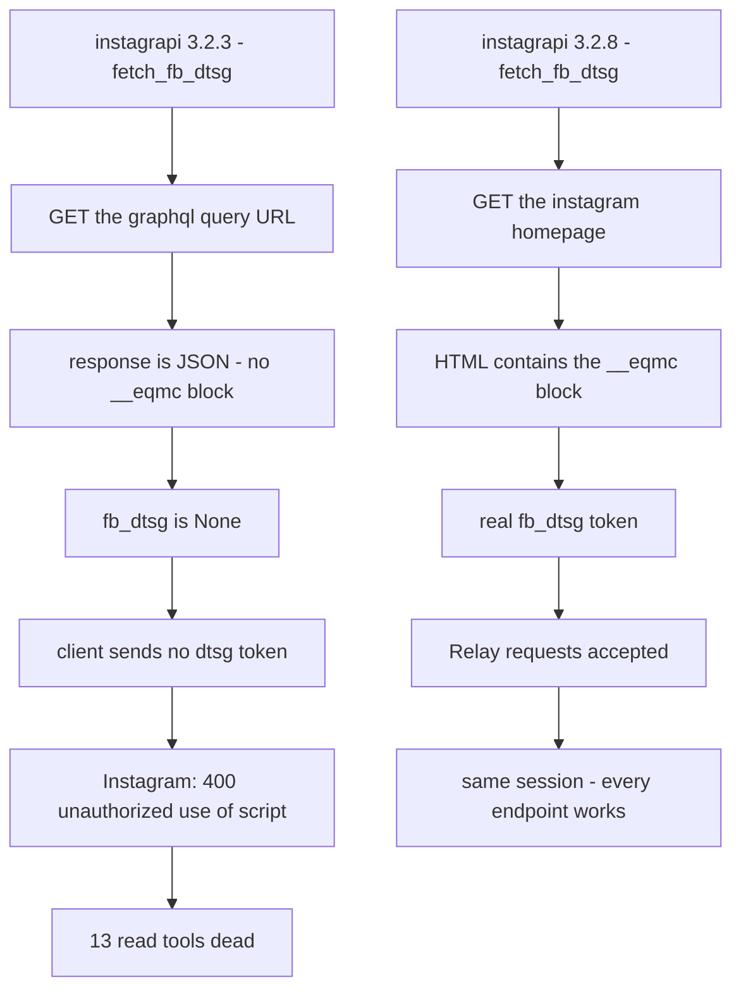
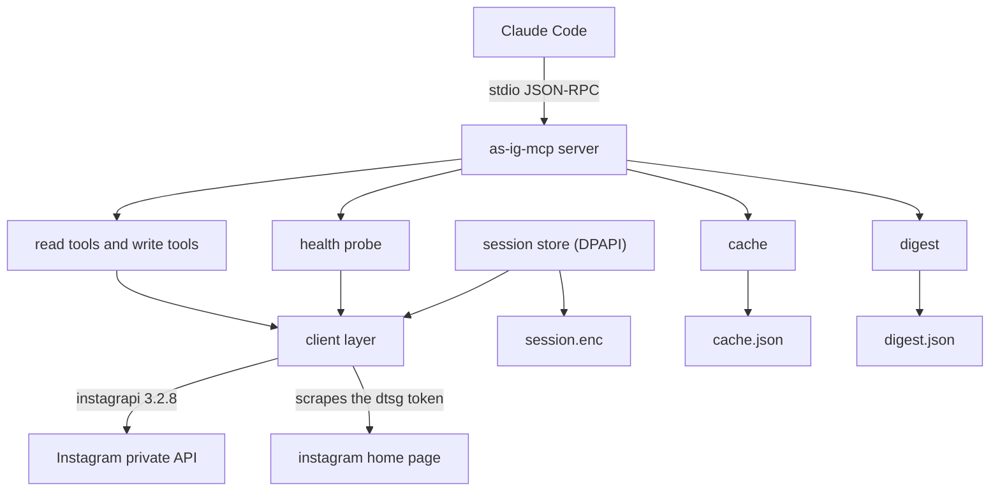
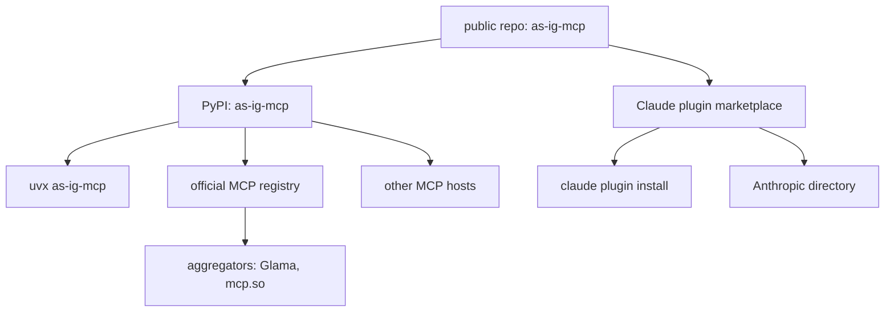

# AS-IG-MCP — Deep Study and Build Blueprint

> **Pitch:** An Instagram MCP for AI agents that (a) reads and sends DMs, (b) reads per-post and account insights, and (c) tells you *what changed since last time*. Every market tool gives a snapshot; none gives a delta. Most cannot read DMs at all. Ours is one command to install, MIT, and it never posts anything without a human confirm code.

**Status:** root cause proven with live measurements, spec written and awaiting approval, build starts on approval.

**Where the code lives:** `C:\Users\aswat\Downloads\Projects\everyhand-tests` → `mcp/as-ig-mcp/`
**Where the spec lives:** `docs/superpowers/specs/2026-11-10-as-ig-mcp-design.md` in that repo
**Where the scratch probes live:** `C:\Users\aswat\Projects\ig-mcp-probe`

---

## 0. How to read this

Section 2 is the defect and its proof — the reason the vendor tool is half dead.
Section 3 is the market — who exists, who died, and the white space.
Section 4 is the raw material — every Instagram capability we could expose.
Section 5 is our design. Section 6 is how it becomes a standard others install.
Section 7 is the build plan and its kill criteria. Sections 8–10 are risks, decisions, and open questions.

Three agents did the research: market survey, capability inventory (from instagrapi source, local), and adoption/distribution research. Their findings are reproduced in full in sections 3, 4 and 6, with every source URL in Appendix B. Anything unverified is listed in Appendix C and is flagged inline.

---

## 1. Executive summary

**The defect.** The vendor Instagram MCP (`everyhand-instagram`, aichargelabs 0.2.7) fails 13 read tools with `RuntimeError: unauthorized use of script (1:5174)`. Cause, measured: the vendor's frozen binary bundles **instagrapi 3.2.3**, whose `fetch_fb_dtsg()` scrapes `www.instagram.com/graphql/query/...` for the `__eqmc` token block. That URL returns JSON, so the token is always `None`, and Instagram refuses every modern web ("script") endpoint. **instagrapi 3.2.8** scrapes the `www.instagram.com` homepage instead and gets a real token — and then every dead endpoint works on the same session cookies. The vendor binary cannot be patched: its modules live inside the exe archive and `iglib` is pyarmor-obfuscated. No session change fixes it.

**The market.** ~40 Instagram MCP servers are listed on the official registry, most of them public-profile scrapers with no write and no analytics. SaaS schedulers (Buffer, Hootsuite, Postiz, Metricool, Mixpost, Blotato, Inrō, Upload-Post) do posts and scheduling well but mostly cannot read DMs, and Hootsuite deliberately blocks outbound replies through MCP. Private-API MCPs are thin or abandoned; 7+ projects are dead (18 months stale, 404 links still listed on directories). instagrapi itself (7,092 stars) now advertises a paid SaaS in its README — the maintainers are signalling that the private API is eroding.

**The white space** (missing from *every* product found): a *what changed* delta digest; per-post insights time-series; an approval queue for outbound DMs; one surface that does DMs + posts + insights together; realtime DM push without the private API.

**Our answer.** AS-IG-MCP: 13 intent-level tools (not 35), reads and writes DMs, reads per-post and account insights, a digest that reports deltas, a health probe that says which calls are alive, and a confirm-code gate on every write. Built on pinned instagrapi 3.2.8 so the next Instagram change is a version bump, not a rewrite.

**The catch we accept.** The private API is unstable and can get an account flagged. That is why every write needs a human confirm code, reads are cached, and `ig_health` exists. The alternative surfaces (official API, browser automation) each fail worse for this use case — see 3.3 to 3.5.

---

## 2. The defect, proven

### 2.1 Symptom

Vendor MCP, live calls, 2026-11-10:

| Tool | Result |
|---|---|
| `ig_list_threads` | `RuntimeError: unauthorized use of script (1:5174)` |
| `ig_read_messages` | same |
| `ig_user_media` (posts/reels/timeline) | same |
| `ig_followers` (followers/following/suggested) | same |
| `ig_stories` action=tray | same |
| `ig_discover` hashtag_top / hashtag_recent / users / music | same |
| `ig_draft_reply`, `ig_compose` | same (they call the above) |
| `ig_discover` location_search | `ClientNotFoundError: 404` on `https://www.instagram.com/web/search/topsearch/` — Instagram deleted that endpoint |
| `ig_discover` places | `lat and lng required for places (or set IG_PLACES_LAT / IG_PLACES_LNG)` |

Working: `ig_status`, `ig_account` (info), `ig_user_info`, `ig_get_thread`, `ig_search_messages`, `ig_search`, `ig_presence`, `ig_pending_requests`, `ig_triage`, `ig_stories` list/archive/highlights, `ig_notes` list, `ig_relationship` status, `ig_discover` hashtag/hashtags_followed/explore, and the five local reply-style tools. **19 of 36 probed read calls work.**

### 2.2 Root cause chain



### 2.3 Measured evidence, same account, same session

| Probe | instagrapi 3.2.3 (vendor) | instagrapi 3.2.8 (ours) |
|---|---|---|
| `fb_dtsg` | `None` | `NAfy5kMv8GRdAA2JMQAPCkhvTdjL…` |
| `user_followers` | error | 242 followers |
| `user_medias` | error | 5 media |
| `direct_threads` | error | 10 threads |
| `explore_page` | error | 16 items |
| `user_stories_web` | n/a | ok |
| `direct_messages` (thread `340282366841710301244259146818785935725`) | error | 4 messages, including our own "hi" |

Side-by-side on that same thread, same moment: vendor `ig_read_messages` → `RuntimeError: unauthorized use of script (1:5174)`; our client → the 4 messages.

Login worked with one emailed 6-digit code. Cookies returned: `csrftoken`, `ds_user_id`, `rur`, `sessionid`. Chrome on this machine has **zero** instagram cookies (checked both profiles), so there is no web session to reuse.

### 2.4 Why the vendor cannot be fixed

- Vendor exe is PyInstaller onedir: pure-Python modules are inside the exe PYZ, so editing `_internal/instagrapi/*.py` has no effect.
- `iglib` is pyarmor-obfuscated (`pyarmor_runtime_011994`).
- The vendor CLI does expose `login --sessionid-env IG_SESSIONID` — "reuse a browser session cookie instead of a password" — which proves the vendor knows web sessions matter. It cannot help: 3.2.3 computes `fb_dtsg = None` whatever session it holds.

### 2.5 Why not the other surfaces

| Surface | Why it fails for this job |
|---|---|
| Official Graph API | DM read needs `instagram_business_manage_messages` **Advanced Access** (Meta app review: business verification, privacy policy, screencasts, weeks, common rejection). Returns only the 20 newest messages per conversation, drops Requests threads inactive >30 days, and replies outside a 24-hour (or 7-day click-to-Direct) window fail. It is the right surface for *public* data; it cannot be the base for DM-first work. |
| Browser automation (e.g. inssist) | Needs a permanently running, logged-in Chrome, breaks when Instagram changes a button, slow, and cannot produce clean structured data. Fine as a credential fallback, wrong as the read path. |
| Hosted credential proxy (Unipile) | Moves the ban risk to a vendor and still cannot do posts, insights or profile. |
| Private API (instagrapi) | Unstable and can trip account checks — but it is the only surface that gives DMs + posts + insights + stories in one place, and we can pin the version and gate every write. **This is the surface we chose, deliberately.** |

---

## 3. Market study

### 3.1 The vendor we replace — `everyhand-instagram` (aichargelabs 0.2.7)

Read from the installed package (`aichargelabs_instagram_mcp-0.2.7.dist-info/METADATA` and `bin/README.md`):

- 35 tools, all prefixed `ig_`, grouped: read messages (11), send/manage (7), reply help (5), posts/people/stories (11), daemon (1).
- Built on a vendored **instagrapi 3.2.3**, obfuscated with **pyarmor**, closed source, licence-gated (₹5,000 / 6 months / 1 machine; ₹10,000 pre-launch). Vendor calls Instagram a "live beta".
- Surface: **private API**. DM read and send are its core.
- Windows 10/11 64-bit and Apple-silicon macOS only.
- Safety posture: a confirm-code gate on posts, comments, follows — worth matching, not exceeding.
- No code is reusable (proprietary + obfuscated). We compete on behaviour.

### 3.2 The catalogue — every product found, with what it cannot do

Legend: read / write / analytics / DM-read / DM-send. "Manual left" = what a user still does by hand.

| Product                                           | Surface                        | Read                                         | Write                                    | Analytics          | DM r/w                                               | Manual left                                   |
| ------------------------------------------------- | ------------------------------ | -------------------------------------------- | ---------------------------------------- | ------------------ | ---------------------------------------------------- | --------------------------------------------- |
| jlbadano/ig-mcp (206★, MIT, push 2026-02-09)      | Graph API                      | posts, insights, conversations, messages     | publish_media, send_dm                   | per-post + account | y/y (Advanced Access)                                | comments, scheduling                          |
| mcpware/instagram-mcp (76★, npm, push 2026-09-13) | Graph API                      | 23 tools incl. DM read                       | publish, reply, send DM                  | yes                | y/y                                                  | scheduling                                    |
| subzeroid/instagrapi (7,092★, push 2026-11-09)    | private API library            | full                                         | full                                     | full               | y/y                                                  | nothing (library)                             |
| taskmaster-ai/insta-mcp (18★, push 2026-08-09)    | instagrapi                     | `read_dms` only                              | `send_dm`                                | none               | y/y                                                  | everything else                               |
| rayenking/instagrapi-mcp (1★, created 2026-10-31) | instagrapi                     | 34 tools                                     | yes                                      | partial            | y/y                                                  | —                                             |
| anand-kamble/mcp-instagram (9★, push 2026-11-04)  | private API (TS client)        | search, 2FA, DMs                             | yes                                      | —                  | y/y                                                  | —                                             |
| Stupidoodle/instagram-mcp (3★, push 2026-11-09)   | instagrapi + **MQTT push**     | DMs realtime                                 | yes                                      | —                  | y/y                                                  | —                                             |
| inssist/mcp (14★, push 2026-10-19)                | browser extension, own session | profiles, DMs, insights                      | posts/reels/stories with music, schedule | audience reports   | y/y                                                  | browser must stay open                        |
| AleemHaider/instagram-mcp (9★)                    | Graph API                      | 24 tools, comments, DMs, insights            | publish, comment                         | yes                | y/y                                                  | —                                             |
| adelaidasofia/instagram-mcp (17★)                 | Graph API                      | multi-account                                | publish, comments                        | yes                | —                                                    | review gate                                   |
| IvanBBaev/instagram-mcp (7★)                      | Graph API                      | 28 pro-account tools                         | publish                                  | yes                | —                                                    | —                                             |
| HasData/instagram-mcp (12★)                       | hosted, public data            | public profiles/feeds                        | none                                     | engagement         | n/n                                                  | everything                                    |
| Upload-Post MCP (16★, push 2026-11-09)            | SaaS                           | 50 tools / 22 networks, comments             | publish, schedule, auto-DMs              | yes                | y/y                                                  | —                                             |
| Postiz MCP (self-host)                            | SaaS/self-host                 | 30+ channels                                 | post/carousel/reel, schedule             | yes                | n/n                                                  | inbox                                         |
| Mixpost MCP (self-host)                           | self-host                      | list accounts/posts                          | draft/schedule                           | no                 | n/n                                                  | inbox, comments                               |
| Metricool MCP                                     | SaaS                           | posts/reels/stories, competitors             | schedule                                 | strong + best-time | n/n                                                  | no inbox tool despite having an Inbox product |
| Buffer MCP                                        | SaaS                           | queue, channels                              | draft/schedule                           | insights           | n/n                                                  | no comment reply                              |
| Hootsuite MCP                                     | SaaS                           | Perch metrics, Nest inbox, Lumen listening   | Perch publish, Parliament schedule       | strong             | read via Nest (IG not named) / **no outbound reply** | outbound replies                              |
| Blotato MCP (36 tools)                            | Graph API                      | comments, conversations, messages, analytics | post/schedule/comment/DM                 | yes                | y/y                                                  | —                                             |
| Inrō MCP (25+ tools)                              | Meta Business API              | conversations, campaigns                     | DM, folders, automations                 | funnel             | y/y                                                  | —                                             |
| Unipile                                           | private API (user/pw)          | inbox, read receipts, attachments            | DM send                                  | none               | y/y                                                  | posts, insights, profile                      |
| Ayrshare (docs + action MCP)                      | SaaS API                       | posts                                        | publish/schedule                         | via API            | n/n                                                  | —                                             |
| Sprout Social                                     | SaaS (third-party MCP)         | Smart Inbox, Trellis                         | Smart Inbox                              | strong             | read (UI)                                            | —                                             |

The official MCP registry lists **40+ Instagram servers**, mostly public-data discovery (`co.instavision/instagram-discovery`, `com.52choujiang/instagram-insights`). smithery.ai and mcp.so each surface only a handful.

### 3.3 The official API route and its walls

- DM read via Graph needs `instagram_business_manage_messages` **Advanced Access**: business app, privacy policy, screencasts, business verification. Weeks, and rejection is common. This is a schedule risk, not a config step.
- Only the **20 newest messages per conversation** are returned.
- Requests-folder threads inactive more than **30 days** are dropped.
- Replies outside a **24-hour** window (or 7-day click-to-Direct window) fail.
- Graph DMs, comments and insights are **professional-account only**. A creator on a personal account silently loses most of the surface.
- Basic Display API was deprecated Dec 2024 — this is what killed several read-only servers (see 3.7).

### 3.4 The private API route and its decay

instagrapi is 7,092 stars, pushed 2026-11-09, and its README now advertises a **paid SaaS (HikerAPI)** — the maintainers' own signal that the private API is eroding. Every private-API MCP is therefore a maintenance liability by construction; ours is a maintenance liability we control (pinned version, one mapping table, one version bump to fix).

### 3.5 The browser route

`inssist/mcp` is the cleanest browser example: real session, real insights, posts with music, scheduling — but the browser must stay open and logged in, and Instagram can change the DOM under it. Good credential fallback, bad read path.

### 3.6 The SaaS schedulers

Buffer: queue + schedule + insights, no DM read, no comment reply. Hootsuite: strongest analytics and inbox, but **no outbound reply through MCP**. Metricool: best-time-to-post and competitor analysis, no inbox tool. Postiz/Mixpost: many channels, no DM read. Blotato: 36 Graph-API tools with DM and comments. Inrō: funnel + campaigns via Meta Business API. Upload-Post: 50 tools, auto-DMs. Unipile: DM-first, no posts or insights. Ayrshare: publish/schedule only.

### 3.7 Dead projects and why they died

| Project | Stars | Last push | Why it died |
|---|---|---|---|
| Bob-lance/instagram-engagement-mcp | 47★ | 2025-04-26 (~18 months stale) | comments/analytics only, no write; Basic Display deprecation |
| manideep1428/instagram_MCP | 3★ | 2025-05-27 | pinned to Graph v22.0 |
| zegh6389/news-instagram-mcp | 2★ | 2025-07-24 | abandoned |
| supercorp-ai/instagram-mcp | 2★ | 2025-10-17 | abandoned |
| CDataSoftware/instagram-mcp-server-by-cdata | 4★ | 2025-10-18 | read-only, abandoned |
| alexfisenkov/instagram-mcp-starter | 2★ | archived | starter template, never finished |
| ploy919/instagram_dm_mcp | — | repo 404s on GitHub | still listed on glama.ai — a dead link in a live directory |

Root causes of death: Basic Display API deprecation (Dec 2024), Graph version pinning, and Meta's Advanced Access wall that indie DM projects cannot clear. **Also noted:** `mcpware/instagram-mcp`'s README is byte-identical to `jlbadano/ig-mcp`'s — same badges, same text — i.e. a re-skin, not independent work.

### 3.8 The ten features that appear most often

Scheduled publishing; publish post/carousel/reel/story; DM conversation read; DM send; comment read + reply; per-post insights; media upload plus AI image/video generation; multi-account/channel management; an approval/review gate before publish; hashtag/competitor discovery and best-time-to-post.

### 3.9 White space — missing from *every* product found

1. **A "what changed" delta digest.** Every analytics tool returns a snapshot; none returns "since your last visit".
2. **Per-post insights time-series.**
3. **An approval queue for outbound DMs.** Hootsuite can read but not reply; Buffer cannot even read.
4. **Realtime DM push for Graph-API apps** (only private-API or browser tools push).
5. **Graph-API DM read without Advanced Access.**
6. **One surface that does DMs + posts + insights together.** Unipile does DM only; schedulers do posts only.
7. **Team roles and assignment** (Hootsuite only).

AS-IG-MCP targets 1, 2, 3 and 6 directly. It is the only product in this survey that covers private-API DM depth (read, search, triage, send, react, unsend, threads, requests) *and* per-post insights *and* a delta digest in one agent surface.

---

## 4. Capability inventory — instagrapi 3.2.8 (the raw material)

Read from the installed source at `…\site-packages\instagrapi\mixins\` (40 mixin files) plus `types.py` and `story.py`.

### 4.1 By area (public method names)

**Media publish/upload** — `photo.py`: `photo_upload`, `photo_upload_with_music`, `photo_configure`, `photo_rupload`, `photo_upload_to_story`, `photo_upload_to_story_with_music`, `photo_upload_to_cutout_sticker`, `photo_configure_to_story`, `photo_configure_to_cutout_sticker`, `photo_download*`. `video.py`: `video_upload`, `video_configure`, `video_upload_to_story`, `video_upload_to_story_with_music`, `video_upload_to_cutout_sticker`, `video_upload_to_direct`, `video_rupload`, `video_download*`. `media.py`: `media_upload_status` (async publish poll), `media_create_livestream`, `media_start_livestream`, `media_end_livestream`, `media_get_livestream_info`, `media_get_livestream_comments`, `media_get_livestream_viewers`. `album.py`: `album_upload`, `album_upload_with_music`, `album_configure`. `clip.py`: `clip_upload`, `clip_upload_with_music`, `clip_upload_as_reel_with_music`, `clip_configure`, `clip_info_for_creation`, `clip_interest_topics`, `clip_trial_eligible`, `clip_mashup_info`, `clip_pin`, `clip_unpin`, `clip_change_cover`, `clip_seen`. `igtv.py`: `igtv_upload`, `igtv_configure`. `quicksnap.py`: `quicksnap_send` (audience `mutual_followers`), `quicksnap_history`, `quicksnap_delete`. `crossposting.py`: `media_share_to_fb_unified_config`, `media_share_to_fb_connected_services_config`, `media_share_to_fb_destination`, `media_share_to_threads_config`, `media_share_to_threads_destination`.

**Albums / carousels** — `album_upload`, `album_upload_with_music`, `album_configure`, `album_download*`. Insights reports `POST_TYPE = "CAROUSEL_V2"`.

**Reels / clips** — the `clip_*` set above, plus `timeline.py`: `reels`, `explore_reels`, `friends_reels`, `reels_timeline_media`, and `media_link_reel` (link one Reel to another, "Watch Next").

**Stories** — `story_info_v1`, `story_info`, `story_delete`, `user_stories*` (gql/web/v1), `archive_story_days_v1`, `archive_stories_v1`, `story_seen`, `story_viewers`, `story_likers`, `story_like`, `story_unlike`, `story_poll_vote`, `sticker_tray`, `story_download*`, `story_pk_from_url`. Sticker and mention types: `StoryMention`, `StoryHashtag`, `StoryLocation`, `StorySticker`, `StoryStickerLink`, `StoryLink`, `StoryPoll`, `StoryMedia`. Root `story.py` has `StoryBuilder` (`build_main`, `video`, `video_fit`, `photo`).

**Highlights** — `highlight_pk_from_url`, `user_highlights_v1`, `user_highlights`, `highlight_info_v1`, `highlight_info`, `highlight_create` (needs `story_ids`), `highlight_edit`, `highlight_change_title`, `highlight_change_cover`, `highlight_add_stories`, `highlight_remove_stories`, `highlight_delete`.

**Comments and moderation** — `media_comments`, `media_comments_v1`, `media_comments_gql`, `media_comments_public_gql`, `media_comments_threaded_gql`, `media_stream_comments_v1_chunk`, `media_comment`, `media_comment_replies`, `media_comment_infos`, `comment_like`, `comment_unlike`, `comment_pin`, `comment_unpin`, `comment_bulk_delete`, `comment_likers_gql`, `media_check_offensive_comment`, `media_check_offensive_comment_v2`. Note: `comment_bulk_delete` modifies other people's comments → needs confirm.

**Hashtags / locations / search** — `hashtag.py`: `hashtag_info*`, `hashtag_medias_top`, `hashtag_medias_recent`, `hashtag_medias_reels`, `hashtag_medias_paginated*`, `iter_hashtag_medias`, `hashtag_follow` (unfollow flag), `hashtag_following`, `hashtag_unfollow`. `location.py`: `location_search`, `location_search_name`, `location_search_pk`, `location_complete`, `location_build`, `location_story_sticker_id`, `location_info*`, `location_medias_top`, `location_medias_recent`, `location_guides_v1`. `fbsearch.py`: `fbsearch_places`, `web_search_topsearch`, `search_users`, `search_music`, `search_hashtags`, `fbsearch_suggested_profiles`, `fbsearch_accounts_v2`, `fbsearch_reels_v2`, `fbsearch_typeahead_stream`, `media_search`, `fbsearch_recent`, `fbsearch_item`.

**Users / profiles / follows** — `user.py`: `user_info*`, `user_about_v1`, `user_followers*`, `user_following*`, `user_follow`, `user_unfollow`, `user_block`, `user_unblock`, `user_report`, `user_remove_follower`, `mute_posts_from_follow`, `mute_stories_from_follow`, `enable/disable_{posts,videos,reels,stories}_notifications`, `close_friend_add`, `close_friend_remove`, `creator_info`, `user_guides_v1`, `user_suggested_profiles`, `address_book_link`, `address_book_unlink`, `user_follow_requests*`, `user_follow_request_approve`, `user_follow_request_decline`, `user_follow_requests_approve`, `user_follow_requests_decline`, `discover_recommended_accounts_for_category_v1`. `account.py`: `account_info`, `account_edit`, `account_set_biography`, `account_set_private`, `account_set_public`, `account_change_picture`, `account_set_ai_info`, `account_security_info`, `account_convert_to_professional`, `account_convert_to_business`, `account_convert_to_creator`, `change_password`, `reset_password`, `remove_bio_links`, `set_external_url`, `news_inbox_v1`, `send_email`, `confirm_email`, `send_phone_number`, `confirm_phone_number`. `multiple_accounts.py`: `featured_accounts_v1`, `get_account_family_v1`.

**Direct messages (50 methods)** — `direct_threads`, `direct_threads_chunk`, `direct_thread`, `direct_thread_by_participants`, `direct_thread_create` (group, needs ≥2 `user_ids`), `direct_thread_add_users`, `direct_thread_update_title`, `direct_thread_hide`, `direct_thread_mute`, `direct_thread_unmute`, `direct_thread_mute_video_call`, `direct_thread_unmute_video_call`, `direct_thread_mark_unread`, `direct_messages`, `direct_message`, `direct_answer`, `direct_send`, `direct_send_reaction`, `direct_delete_reaction`, `direct_message_like`, `direct_message_unlike`, `direct_send_photo`, `direct_send_video`, `direct_send_voice`, `direct_send_file`, `direct_send_cutout_sticker`, `direct_media_share`, `direct_story_share`, `direct_profile_share`, `direct_message_delete`, `direct_message_unsend`, `direct_message_seen`, `direct_send_seen`, `direct_presence`, `direct_active_presence`, `direct_users_presence`, `direct_search`, `direct_message_search`, `direct_search_gen_ai_bots`, `direct_channels`, `direct_pending_inbox`, `direct_pending_requests_preview`, `direct_pending_chunk`, `direct_pending_approve`, `direct_request_approve`, `direct_spam_inbox`, `direct_set_e2ee_eligibility`, `direct_has_interop_upgraded`.

**Notes** — `note.py`: `get_notes`, `get_note_by_user`, `get_note_text_by_user`, `create_note` (audience `MUTUAL_FOLLOWERS` / `CLOSE_FRIENDS`), `create_music_note` (needs `track` + browse/alacorn session ids), `delete_note`, `last_seen_update_note`, `notes_music_browser`. Plus `media_note_create` / `media_note_delete` — a note attached to a post (different feature).

**Insights (business/creator only)** — `insights.py`: `insights_account` (surface `account`), `insights_media(media_pk)` (surface `post`), `insights_media_feed_all(post_type, time_frame, data_ordering, count, sleep)` (surface `post_grid`, cursor-paginated). Windows: `ONE_WEEK`, `ONE_MONTH`, `THREE_MONTHS`, `SIX_MONTHS`, `ONE_YEAR`, `TWO_YEARS`. `POST_TYPES` includes `SHOPPING`. Ordering keys: `REACH_COUNT`, `IMPRESSION_COUNT`, `PROFILE_VIEW`, `VIDEO_VIEW_COUNT`, `SAVE_COUNT`, `SHARE_COUNT`, `BIO_LINK_CLICK`, `FOLLOW`, `COMMENT_COUNT`, `LIKE_COUNT`.

**Music / tracks** — `track.py`: `music_in_feed_audio_browser`, `music_trending`, `music_top_trends`, `music_search_v2`, `music_keyword_search`, `music_bookmark`, `music_bookmarked`, `music_clips_audio_browser`, `music_verify_original_audio_title`, `track_info_by_id`, `track_info_by_canonical_id`, `track_stream_info_by_id`, `track_download_by_url`.

**Saved collections** — `collection.py`: `collections`, `collection_pk_by_name`, `collection_medias_by_name`, `collection_medias_v1`, `collection_medias` (`last_media_pk` cursor), `collection_medias_v1_chunk`, `media_save`, `media_unsave`, `liked_medias`.

**Guides / misc reads** — `user_guides_v1`, `location_guides_v1`, `standalone_fundraiser_info_v1`, `share_info`, `share_info_by_url`, `share_code_from_url`, `explore_page`, `explore_page_media_info`, `report_explore_media`, plus `realtime_connect` / `fbns_connect` sockets for live messaging and ~34 `bloks_*` methods.

**Notifications (~30 readers)** — `notification.py`: `notification_likes`, `notification_comments`, `notification_new_follower`, `notification_follow_request_accepted`, `notification_user_tagged`, `notification_view_count`, `notification_live_broadcast`, `notification_video_call`, `notification_rooms`, `notification_direct_group_requests`, `notification_fundraiser_*`, `notification_reminders`, `notification_announcements`, `notification_login`, `notification_felix_upload_result`, `notification_settings`, `notification_disable`, `notification_mute_all` (cancel / 15_minutes / 1_hour / 2_hour / 4_hour / 8_hour).

### 4.2 Capabilities that need extra state or extra approval

| Capability | Method(s) | Business/creator only | Extra parameters |
|---|---|---|---|
| Collaboration (co-author invite) | `photo_upload`, `video_upload`, `album_upload` (`coauthor_user_ids`) | no | list of user ids → `invite_coauthor_user_ids`. **No `accounts/collaborate_invite` endpoint exists — not present.** |
| Scheduled publish | `schedule_at` on `photo_upload` / `video_upload` / `album_upload` | no | int or datetime → `publish_mode="scheduled"` + `scheduled_publish_time` |
| Cross-post Facebook / Threads | `share_to_facebook`, `share_to_threads`, `fb_destination_id`, `fb_destination_type`, `threads_destination_id`, `fb_validation_bypass`, `fb_xpost_surface` | no | destination ids + validation-bypass tokens |
| Insights | `insights_account`, `insights_media`, `insights_media_feed_all` | **yes** (`shadow_instagram_user.business_manager`) | `time_frame`, `post_type`, `data_ordering`, cursor, `count`, `sleep` |
| Professional conversion | `account_convert_to_professional` / `_business` / `_creator` | becomes one | `category_id` (default `2347428775505624`), `to_account_type` 2=business 3=creator, `entry_point` |
| AI label | `account_set_ai_info(enabled)` | no | — |
| Close friends | `close_friend_add`, `close_friend_remove`, `NoteAudience.CLOSE_FRIENDS` | no | user_id |
| DM group threads | `direct_thread_create` (≥2), `direct_thread_add_users`, `direct_thread_update_title`, `direct_thread_hide` | no | thread id + user id lists |
| DM moderation | `direct_pending_approve`, `direct_request_approve`, `direct_spam_inbox`, `direct_thread_hide`, `direct_message_delete`, `direct_message_unsend` | no | thread_id, id + secret for invites |
| Message requests | `direct_pending_inbox`, `direct_pending_requests_preview`, `direct_pending_chunk` | no | `pending_inbox_filters` |
| Comment moderation | `comment_bulk_delete`, `comment_pin`, `comment_unpin`, `media_check_offensive_comment(_v2)` | no | media id + comment pks |
| Media notes (post notes) | `media_note_create(media_id, text, audience=7, note_style=13)`, `media_note_delete` | no | raw audience int |
| Live broadcast | `media_create_livestream`, `media_start/end_livestream`, `media_get_livestream_info/comments/viewers` | no | returns a **stream key** — a credential, not a read |
| Highlight writes | `highlight_create`, `highlight_change_title`, `highlight_change_cover`, `highlight_add_stories`, `highlight_remove_stories`, `highlight_delete` | no | `story_ids`, `cover_story_id`, `crop_rect` |
| Music notes | `create_music_note`, `notes_music_browser` | no | `track`, `browse_session_id`, `alacorn_session_id`, `start_time`, `duration` |
| Business DM inbox box | `direct_threads(box="general")`, `direct_threads_chunk(box=…)` | **yes** ("business accounts only" per docstring) | box filter |
| Notification settings | `notification_settings`, `notification_mute_all`, `notification_disable` | no | enum of content types |
| Multi-account family | `featured_accounts_v1(target_user_id)`, `get_account_family_v1` | no | user id |

### 4.3 Not available in instagrapi — do not plan these

- **Branded content / partnership ads write API** — read-side types only (`ClipsBrandedContentTagInfo`, `Media.is_paid_partnership`, `Story.is_paid_partnership`).
- **Shopping products / DM products** — only `product_type` on media, `POST_TYPE="SHOPPING"` in insights, `shopping_info` on `Media`.
- **Location creation** — only resolve-existing (`location_complete`, `location_build`).
- **DM broadcast lists** — `broadcast/` is only the internal prefix for 1:1 sends.
- **Publishing quota / limit endpoint** — limits are implicit 429s.
- **Story repost** — closest is `media_share_to_story` (own feed media → your story).

### 4.4 Reads that only business/creator accounts get

`insights_account`, `insights_media_feed_all` (hard-checked in source), `insights_media` (in practice), `direct_threads(box="general")`, `user_about_v1`, `creator_info`, `account_security_info` (business variant).

---

## 5. Our design: AS-IG-MCP

### 5.1 Position

> The Instagram MCP for AI agents that reads DMs, measures posts, and reports what changed.

- **Surface:** private API (instagrapi 3.2.8, pinned). Chosen because it is the only surface that gives DMs + posts + insights + stories in one place.
- **Account:** one, business (so insights and the general DM box work). Multi-account deferred.
- **Name:** AS-IG-MCP. Claude Code server id `as-ig`. Python package `as-ig-mcp`, module `as_ig_mcp`.
- **Tools:** 13, all `ig_`, every description tagged `[AS-IG-MCP]`.
- **Transport:** stdio. State in files so several Claude Code sessions share it.

### 5.2 The 13 tools

| Tool | Replaces (vendor) | Key parameters | What it does |
|---|---|---|---|
| `ig_status` | `ig_status`, `ig_account` (read) | — | session state, account, quota, cache state, one-line health |
| `ig_inbox` | `ig_triage`, `ig_draft_reply`, `ig_compose` | `hours`, `limit`, `suggest=true` | threads awaiting a reply, last message, optional suggested reply from our style file |
| `ig_thread` | `ig_get_thread`, `ig_read_messages`, `ig_mark_seen`, `ig_react`, `ig_unsend` | `thread_id`, `cursor`, `limit`, `mark_seen` | full thread, paginated messages, presence, per-thread actions |
| `ig_person` | `ig_user_info`, `ig_relationship` (read), `ig_followers`, `ig_stories` (list/highlights), `ig_media`, `ig_comments` (read) | `username`\|`user_id`, `include=followers,following,posts,stories,highlights,comments` | one profile call with optional includes |
| `ig_people` | `ig_followers` (following, suggested) | `username`, `kind`, `cursor` | paginated follower/following/suggested lists |
| `ig_search` | `ig_discover` (all kinds), `ig_search`, `ig_search_messages` | `kind=user\|hashtag\|place\|music\|post\|message`, `query`, `cursor` | one search tool, ids and links back so follow-ups are cheap |
| `ig_feed` | `ig_user_media` (posts/reels/tagged/saved/archive), `ig_stories tray` | `kind=posts\|reels\|tagged\|saved\|archive\|notifications\|collections\|guides\|tray`, `username`, `cursor`, `include=comments` | paginated feed for any account or ours |
| `ig_story` | `ig_stories` (info/viewers/likers/download), `ig_highlights` (read) | `story_id`\|`highlight_id`, `action` | story and highlight detail, download |
| `ig_digest` | — (new) | `since=last`\|iso date | what changed: new DMs, new followers, new posts, story updates |
| `ig_insight` | — (new) | `kind=media\|account\|best\|compare`, `media_pk`, `time_frame`, `order_by` | per-post metrics, account metrics, Instagram's own ranking, side-by-side comparison |
| `ig_write` | `ig_send_message`, `ig_send_media`, `ig_share`, `ig_publish`, `ig_comments` (post/delete/like/pin), `ig_relationship` (writes), `ig_notes`, `ig_highlights`, `ig_account` (edit), `ig_set_profile` | `kind`, action params, `idempotency_key` | every write, one confirm gate |
| `ig_health` | — (new) | — | live/dead per endpoint class, with the fix named when dead |
| `ig_session` | — (new) | `action=status\|relogin\|cache_clear\|export` | relogin with the emailed code, clear cache, export session |

### 5.3 Architecture



### 5.4 Write gate (the trust posture)

Every write: first call stores the action, returns `needs_confirm` + the exact text that would be sent + a 6-digit code, and performs nothing. Second call with the matching code executes once. Codes are single-use, expire in 6 minutes, and an idempotency key makes a repeat a no-op ("already done"). No write is auto-retried after a partial failure. This matches the vendor's posture, and goes one step further with the idempotency key.

### 5.5 Cache, digest, health

- **Cache:** 90-second TTL on reads, `fresh=true` to bypass, stored in `cache.json` with atomic writes. Cuts Instagram calls and reduces the chance of tripping rate limits or account checks.
- **Digest:** `digest.json` holds last-seen markers (last message id per thread, follower count, last post pk, story ids). `ig_digest` returns what changed and rewrites the markers. Second call in a row reports nothing — the test that proves it works.
- **Health:** one call per endpoint class (REST profile, GraphQL feed, GraphQL followers, GraphQL threads, GraphQL search, GraphQL stories, DM read, DM write preview, insights). Output: live/dead per class, plus the remedy when dead (usually "bump instagrapi").

### 5.6 Session and login

- Our own session store, DPAPI-encrypted to the current Windows user (`%APPDATA%\as-ig-mcp\session.enc`).
- Login needs one emailed 6-digit code (Instagram sends it to the account's own mailbox).
- `ig_session relogin` re-runs login and rewrites the encrypted file.
- Device trust binds the app profile, so `override_app_version=False` is load-bearing — the session must keep the app profile Instagram accepted at login.
- One live login on the account: our session is injected into the vendor daemon with `instagram-mcp.exe login --sessionid-env IG_SESSIONID`, so both servers share one `sessionid`.

### 5.7 Vendor tool → our tool map

| Vendor | Ours | | Vendor | Ours |
|---|---|---|---|---|
| `ig_status` | `ig_status` | | `ig_publish` | `ig_write kind=publish` |
| `ig_triage` | `ig_inbox` | | `ig_media` | `ig_feed` / `ig_story` |
| `ig_draft_reply`, `ig_compose` | `ig_inbox suggest=true` | | `ig_comments` (read) | `ig_person include=comments` |
| `ig_list_threads` | `ig_thread` | | `ig_comments` (write) | `ig_write kind=comment` |
| `ig_get_thread` | `ig_thread` | | `ig_relationship` (read) | `ig_person` |
| `ig_read_messages` | `ig_thread` | | `ig_relationship` (write) | `ig_write kind=follow` |
| `ig_search_messages` | `ig_search kind=message` | | `ig_followers` | `ig_people`, `ig_person` |
| `ig_search` | `ig_search kind=user` | | `ig_stories` | `ig_feed kind=tray`, `ig_story` |
| `ig_user_info` | `ig_person` | | `ig_highlights` | `ig_story`, `ig_write kind=highlight` |
| `ig_presence` | `ig_thread` (presence) | | `ig_notes` | `ig_write kind=note` |
| `ig_pending_requests` | `ig_thread kind=requests` | | `ig_account` (read) | `ig_status` |
| `ig_user_media` | `ig_feed` | | `ig_account` (edit) | `ig_write kind=profile` |
| `ig_discover` (7 kinds) | `ig_search` (6 kinds) | | `ig_set_profile`, `ig_get_profile`, `ig_list_profiles` | local style file in `ig_inbox` |
| `ig_send_message`, `ig_send_media`, `ig_share` | `ig_write kind=send_message\|send_media\|share` | | `ig_daemon`, `ig_download_media` | `ig_session`, `ig_story` (download) |
| `ig_react`, `ig_unsend`, `ig_mark_seen`, `ig_thread` | `ig_write kind=react\|unsend\|mark_seen\|thread` | | | |
| — | `ig_digest`, `ig_insight`, `ig_health` | | | |

### 5.8 Which white space we fill

| White space from 3.9 | Our answer |
|---|---|
| "What changed" delta digest | `ig_digest` with file-backed markers |
| Per-post insights time-series | `ig_insight kind=media` + `kind=best` (Instagram's own ordering) + `kind=compare` |
| Approval queue for outbound DMs | `ig_write` confirm gate + `ig_inbox` drafts the reply for a human to approve |
| Realtime DM push | not in v1 (private API has no push; the MQTT competitor needs a broker). Deferred deliberately |
| Graph-API DM read without Advanced Access | we use the private API, so no review wall at all |
| One surface for DMs + posts + insights | 13 tools, one server, one session |
| Team roles | out of scope for a single-user local tool |

---

## 6. Making AS-IG-MCP a standard

### 6.1 Ranked checklist — installable in one command

1. **Publish to PyPI (blocking prerequisite for the official registry).** Name `as-ig-mcp`. Then:
   ```bash
   uvx as-ig-mcp
   pipx run as-ig-mcp
   ```
   The registry verifies ownership by finding `mcp-name: $SERVER_NAME` in the package README — it may sit in an HTML comment, but the name must match exactly:
   ```markdown
   <!-- mcp-name: io.github.aswathas/as-ig-mcp -->
   ```
2. **Publish `server.json` to the official MCP Registry** (`registry.modelcontextprotocol.io`, preview):
   ```bash
   mcp-publisher init
   mcp-publisher login github     # device code flow
   mcp-publisher publish
   ```
   `server.json` needs `$schema: https://static.modelcontextprotocol.io/schemas/2025-12-11/server.schema.json`, `name: io.github.aswathas/as-ig-mcp` (GitHub auth forces the `io.github.<user>/` prefix), `description`, `version`, `repository.url`, and `packages: [{registryType: "pypi", identifier: "as-ig-mcp", version, transport: {type: "stdio"}}]`. **No human review** — the moderation policy is permissive (removes illegal content, malware, spam, non-functioning servers). The registry is a metadata layer; artifacts live on PyPI. Aggregators (Glama, PulseMCP, mcp.so) scrape `GET /v0.1/servers`, so one publish feeds many directories.
3. **Claude Code plugin marketplace** (highest value for this audience):
   ```bash
   claude plugin marketplace add aswathas/as-ig-mcp
   claude plugin install as-ig-mcp@as-ig-mcp
   ```
   One command also exists: `claude plugin install as-ig-mcp --marketplace aswathas/as-ig-mcp` (Claude Code ≥ v2.1.292). Needs a public repo — `everyhand-tests` is private today, so either publish AS-IG-MCP as its own public repo or add a public marketplace repo.
4. **Anthropic's directory** (`claude.ai/directory/manage`) — needs a paid claude.ai plan and a human reviewer; lands in the `claude-community` marketplace (`claude plugin marketplace add anthropics/claude-plugins-community`). Note `anthropics/claude-plugins-community` is a **read-only mirror** synced nightly — PRs are auto-closed, so do not use that route.
5. **Secondary directories:** Glama "Add Server" (ranks by weekly downloads and GitHub stars — download count *is* the discovery currency); mcp.so has a paid submission with publish-immediately; **PulseMCP is paused** for new submissions while they rework ingestion — skip it.
6. **Docker/OCI:** no registry requirement found; unverified as a channel.

### 6.2 The plugin/marketplace layout to copy

Verified locally under `C:\Users\aswat\.claude\plugins\marketplaces\`:

- **`olx-car-search`** — our own precedent and the closest model. `.claude-plugin/marketplace.json` = `{name, owner:{name,url}, plugins:[{name:"olxcars", source:"./", description}]}`. `.claude-plugin/plugin.json` = `{name, description, version, author, homepage, repository, license, keywords, skills:[], mcpServers:{olxcars:{command:"uvx", args:["--from","git+https://github.com/aswathas/olx-car-search","olxcars","mcp"]}}}`.
- **`cloudflare`** — MCP-by-reference: root `.mcp.json` (`{mcpServers:{cloudflare:{type:"http",url:"https://mcp.cloudflare.com/mcp"}}}`) referenced from `.claude-plugin/plugin.json` as `"mcpServers": "./.mcp.json"`.
- **`21st-dev`** — the full three-file shape: root `.mcp.json` + `.claude-plugin/plugin.json` + `server.json` (official registry schema) + `smithery.yaml`.
- **`ponytail`** and **`claude-plugins-official`** — `marketplace.json` with `$schema: https://anthropic.com/claude-code/marketplace.schema.json`, `description`, `owner`, `plugins[]` with `category`/`keywords`; the official one uses remote sources `{source:"git-subdir", url, path, ref, sha}`.

Required marketplace fields: `name`, `owner` (name required), `plugins[]` (each entry needs `name` + `source`). A plugin entry's `name` must equal its `plugin.json` `name`.

### 6.3 Trust signals a social-posting MCP must show

From Anthropic's own pre-submission checklist (https://claude.com/docs/plugins/pre-submission-checklist):

- **LICENSE file** and a **README of at least 40 words** — both hard Blocks.
- **Pinned, exact-version launchers** (`uvx pkg==1.2.3`), never a range or `@latest`, and no custom-registry `.npmrc`/`uv.toml`. An unpinned `uvx --from git+…` is a Block — *our existing `olx-car-search` plugin would fail this.*
- **Secrets never in files.** Credentials come from `userConfig` with `sensitive: true`, referenced as `${user_config.KEY}`; never forward `$GITHUB_TOKEN`-style env vars.
- **A stated data-handling story:** does it read or store personal data, send data beyond its declared connectors, how long does it keep data, does it target under-18s.
- **Describe everything the plugin runs, sends or fetches** in the README; commit readable source, not minified binaries.
- **Tests plus a diagnostic/health tool.** `claude plugin validate --strict ./your-plugin` must print `✔ Validation passed`.
- **Rate-limit and retry behaviour documented**; per-tool `readOnlyHint` / `destructiveHint` / `idempotentHint` / `openWorldHint`.

### 6.4 Tool-design guidance found

- **No fixed per-server tool cap.** "Claude Code doesn't impose a fixed per-server tool cap; the practical limit is your context window budget." Tool search is **on by default**, deferring tool definitions until needed.
- **Description limits are real:** server instructions and upfront tool descriptions are cut at **4,096 chars**; tool-search-loaded descriptions at **16,384**. Put the words Claude would search for near the *start*.
- **Server instructions matter more with tool search** — say what tasks the server handles and when to search for it.
- **Force approval on destructive writes** with `_meta["anthropic/requiresUserInteraction"]: true` in the `tools/list` entry — Claude Code then prompts on every call even under `bypassPermissions`. This is the right slot for our 6-digit confirm code.
- **Tool names:** Claude Code drops any tool whose full name exceeds 128 characters (`mcp__<server>__<tool>`).
- **Naming:** the local `mcp-builder` skill prescribes snake_case, service prefix, verb-first (`slack_send_message`).
- **No authoritative written guidance on one intent-level tool versus many action-level tools — unverified.** With tool search, many focused action-level tools with strong descriptions are defensible; a single `manage_instagram(action=…)` mega-tool makes tool-search matching much worse. Our 13-tool shape sits between the two extremes: `ig_write` with `kind=` is the one place to watch — if its description or payload grows past the limits, split it into `ig_write` (messages/posts) and `ig_manage` (follows, notes, highlights, moderation).

### 6.5 Do not do

1. **Do not depend on Smithery.** `smithery.ai/future` states the MCP Proxy and managed identity shut down **October 31, 2026**; the CLI and SDKs are deprecated and accounts/API keys stop working. It remains only as a public directory.
2. Do not ship `uvx --from git+https://…` in a plugin — an "Unpinned uvx launcher" Block.
3. Do not use reserved names for the marketplace or plugin: `mcp`, `npm`, `pip`, `uv`, `cargo`, `github`, `gh`, `claude`, `anthropic`, `official`, `plugin`, `test`.
4. Do not open PRs against `anthropics/claude-plugins-community` — read-only mirror.
5. Do not put anything on stdout besides JSON-RPC frames (stdio transport).
6. Do not treat a registry listing as trust: the registry explicitly disclaims moderation and says "consumers should assume minimal-to-no moderation."
7. Do not expose `media_create_livestream` — it returns a live stream key, which is a credential.

### 6.6 The adoption pipeline



---

## 7. Build plan

Phase order, each phase ending with a runnable check:

| Phase | Build | Check |
|---|---|---|
| 0 | Vendor bug report (one page: wrong URL, repro, fix) | exists in the repo; if aichargelabs ships 3.2.8 the project can shrink to a config change |
| 1 | Package skeleton, own venv, `session.py` (DPAPI), `client.py` (fb_dtsg prefetch, canonical method per feature) | offline tests pass |
| 2 | Read tools + `ig_health` | 13 dead reads return data; health green |
| 3 | Register in Claude Code | `claude mcp list` shows it; a clean session calls a tool |
| 4 | `ig_write` with confirm gate and idempotency, `ig_session` relogin | write-gate test passes; relogin works |
| 5 | `cache.py`, `digest.py`, `ig_digest` | digest quiet on the second call |
| 6 | `ig_insight` (media, account, best, compare) | metrics match Instagram's own numbers |
| 7 | Inject our session into the vendor daemon | one login on the account |
| 8 | README, `tool-map.md`, audit log, repo commit | a stranger can install and run it |

**Kill criteria** (stop and rethink if any is true):
- Instagram blocks the private API for this account twice in a row despite throttling → the surface is gone; switch to Graph API for public data and keep DM work manual.
- Insights stop being returned for a business account without a Graph migration path → `ig_insight` becomes a manual export feature.
- The confirm gate proves unusable in practice (too many prompts) → redesign the trust model, not the gate.

---

## 8. Risks and mitigations

| Risk | Severity | Mitigation |
|---|---|---|
| Instagram blocks the account for scripted use | High | 90-second cache, throttled reads, confirm gate on every write, `ig_health`, and the option to stop using the tool |
| Upstream endpoint changes again | Medium | one pinned version; the mapping table is the only place to change; `ig_health` detects it early |
| Session dies every few weeks | Medium | `ig_session relogin` (one emailed code); browser-cookie fallback; Graph API as the last resort for public reads |
| Two servers confuse the agent | Medium | `[AS-IG-MCP]` tag in every description; documented ownership map |
| Private API erosion makes the tool obsolete | Medium | it is already the case for instagrapi — the difference is we own the version, the mapping and the escape hatch |
| Graph API advanced-access wall (if we ever add it) | Medium | weeks + rejection risk; treat as a separate project, not a dependency |
| Publishing to the registry without trust signals | Low | the 6.3 checklist, `claude plugin validate --strict`, LICENSE, README, tests, health tool |
| Session cookie leaks | High | DPAPI encryption to the Windows user; never in git, never in the transcript, never in logs |
| `ig_write` becomes a mega-tool and tool-search matching suffers | Low | split into `ig_write` + `ig_manage` if the description exceeds 4,096 chars |

---

## 9. Decisions log

| Date | Question | Answer |
|---|---|---|
| 2026-11-10 | Which route? | A first (vendor re-login), B (own MCP) if A fails → **A proven impossible** (fb_dtsg defect), so B |
| 2026-11-10 | Where does the session come from? | Our own instagrapi login with one emailed 6-digit code → done 2026-11-10 |
| 2026-11-10 | Scope? | Reads **and** writes |
| 2026-11-10 | Where does the implementation live? | The existing `everyhand-tests` repo, new component `mcp/as-ig-mcp/` |
| 2026-11-10 | Which coordinates for `places`? | Not answered — server reads `IG_PLACES_LAT` / `IG_PLACES_LNG` and reports "coordinates not configured" until set |
| 2026-11-10 | Which write tools? | All of them in our server |
| 2026-11-10 | One login or two on the account? | One — inject our session into the vendor daemon |
| 2026-11-10 | Fix the vendor or build better? | Build better — intent-level tools, one search tool, digest, insights |
| 2026-11-10 | Which tool shape? | 13 intent-level tools (after a walkthrough of the same task done three ways) |
| 2026-11-10 | Vendor MCP afterwards? | Keep both registered; our tools tagged `[AS-IG-MCP]` |
| 2026-11-10 | Which half first? | Read side first: session, one read, `ig_inbox`, `ig_health`, then register, then writes, then digest and cache |
| 2026-11-10 | Add Instagram insights? | Yes — the account is a business account and the private API already returns the metrics |
| 2026-11-10 | Video editing? | No — separate product (ffmpeg + video-shotcraft). Posting video stays in scope |
| 2026-11-10 | Name | AS-IG-MCP; server id `as-ig`; package `as-ig-mcp` |

---

## 10. Open questions

1. **Coordinates for `ig_search kind=place`** — needed for place search to work.
2. **Do we want a hosted mode** — a small service so other people can use AS-IG-MCP without a local Python setup? Would need credential handling and a privacy story; probably a separate spec.
3. **Realtime DM push** — private API has no push. The MQTT competitor runs a broker. Worth it only if DM latency matters daily.
4. **Comment auto-reply** — a queue that drafts replies to comments using our style file. Powerful, and a spam risk; needs a rate limit and a review step.
5. **Multi-account** — the code is ready for it (session per account), but it multiplies device-trust risk.

---

## Appendix A — measured numbers (2026-11-10)

- Account: `@this_aswath`, user_id `65590764705`, business account, public, 244 followers, 44 following, 67 media.
- Followers read: 242 via `user_followers_v1`.
- Own media read: 5 recent posts (reels: pks `4024692804391239207`, `4022196238107333326`, `4019396946019845354`, `3877443855851965781`, `3875480356028383511`).
- Threads read: 10 via `direct_threads`.
- Explore read: 16 items.
- Thread `340282366841710301244259146818785935725`: 4 messages, including our own "hi".
- Insights for `4024692804391239207` (posted 2026-11-06): reach 381, impressions 390, likes 22, comments 0, shares 0, profile views 17, feed impressions 74, profile impressions 2, owner follows 1, 5 hashtags.
- Account insights: `has_insights: True`, `account_type: BUSINESS_ACCOUNT`, profile visits 54 (delta 36), website visits 0, followers delta +5 last week, follower gender Men 183 / Women 21, posts 67, last week posts 2 (delta +1), stories `NO_STORIES`.
- `fb_dtsg` from instagrapi 3.2.8: `NAfy5kMv8GRdAA2JMQAPCkhvTdjL…`
- Cookies after login: `csrftoken`, `ds_user_id`, `rur`, `sessionid`.
- Chrome instagram cookies: 0 (both profiles checked).

## Appendix B — sources

Market survey:
https://github.com/topics/instagram-mcp · https://github.com/jlbadano/ig-mcp · https://github.com/mcpware/instagram-mcp · https://github.com/subzeroid/instagrapi · https://github.com/taskmaster-ai/insta-mcp · https://github.com/rayenking/instagrapi-mcp · https://github.com/anand-kamble/mcp-instagram · https://github.com/Stupidoodle/instagram-mcp · https://github.com/inssist/mcp · https://github.com/AleemHaider/instagram-mcp · https://github.com/adelaidasofia/instagram-mcp · https://github.com/IvanBBaev/instagram-mcp · https://github.com/HasData/instagram-mcp · https://github.com/Upload-Post/upload-post-mcp · https://github.com/Bob-lance/instagram-engagement-mcp · https://github.com/CDataSoftware/instagram-mcp-server-by-cdata · https://github.com/alexfisenkov/instagram-mcp-starter · https://github.com/manideep1428/instagram_MCP · https://github.com/official-Arvind/instagram-mcp · https://github.com/oliverames/sprout-mcp-server · https://registry.modelcontextprotocol.io/v0/servers?search=instagram · https://smithery.ai/servers?q=instagram · https://mcp.so/servers?q=instagram · https://glama.ai/mcp/servers/ploy919/instagram_dm_mcp · https://mcpmarket.com/server/instagram-1 · https://developers.facebook.com/documentation/instagram-platform/instagram-api-with-instagram-login/conversations-api · https://developers.facebook.com/documentation/instagram-platform/instagram-api-with-instagram-login/messaging-api · https://aichargelabs.com/products/everyhand/ · https://aichargelabs.com/products/everyhand/pricing/ · https://www.blotato.com/mcp/instagram · https://www.inro.social/guides/mcp-for-instagram · https://postiz.com/mcp · https://mixpost.app/mcp · https://metricool.com/metricool-mcp-claude/ · https://buffer.com/mcp · https://help.hootsuite.com/s/article/about-mcps · https://www.ayrshare.com/docs/additional/mcp-server · https://www.unipile.com/instagram-messaging-api/ · https://www.upload-post.com/mcp/ · https://sproutsocial.com/features/smart-inbox/

Adoption and standards:
https://modelcontextprotocol.io/registry/quickstart · https://modelcontextprotocol.io/registry/package-types · https://modelcontextprotocol.io/registry/moderation-policy · https://modelcontextprotocol.io/registry/registry-aggregators · https://registry.modelcontextprotocol.io/v0.1/servers · https://code.claude.com/docs/en/plugins/publish · https://code.claude.com/docs/en/plugins/plugins-reference · https://code.claude.com/docs/en/plugins/marketplace-reference · https://code.claude.com/docs/en/plugins/create-marketplace · https://code.claude.com/docs/en/plugins/security · https://code.claude.com/docs/en/anthropic-marketplaces · https://claude.com/docs/plugins/pre-submission-checklist · https://claude.com/docs/plugins/submit · https://claude.ai/directory/manage · https://code.claude.com/docs/en/mcp.md · https://code.claude.com/docs/en/permissions.md · https://smithery.ai/future · https://github.com/anthropics/claude-plugins-community · https://glama.ai/mcp · https://mcp.so

Local files:
- `C:\Users\aswat\Downloads\Projects\whatsapp-mcp-venv\Lib\site-packages\aichargelabs_instagram_mcp\bin\README.md` (vendor tool table)
- `…\aichargelabs_instagram_mcp-0.2.7.dist-info\METADATA` (version, pricing, safety claims)
- `…\site-packages\instagrapi\mixins\` (capability inventory)
- `C:\Users\aswat\.claude\plugins\marketplaces\{olx-car-search,cloudflare,21st-dev,ponytail,claude-plugins-official}\` (plugin layout)
- `C:\Users\aswat\.claude\skills\mcp-builder\reference\mcp_best_practices.md`
- `C:\Users\aswat\Downloads\Projects\everyhand-tests\products\instagram\tests\20261105-041400\mcp_tools.txt` (vendor tool list snapshot)

## Appendix C — unverified items

- Whether `mcpware/instagram-mcp` (76★) is a fork of `jlbadano/ig-mcp` — identical README suggests yes, no fork link confirmed.
- Exact tool counts for `rayenking/instagrapi-mcp` (34), `AleemHaider/instagram-mcp` (24), `IvanBBaev/instagram-mcp` (28), `official-Arvind/instagram-mcp` ("68+") — from repo descriptions, not read from source.
- Whether `insights_media` works on a personal account (source hard-checks only `insights_account` and `insights_media_feed_all`).
- Whether `insights_media_feed_all` returns data for our account — the business check should pass, but it has not been called.
- Instagram DM behaviour in Hootsuite Nest, Buffer and Metricool MCP — inferred from published tool lists, not tested.
- Whether Sprout Social ships an official MCP (only a third-party `oliverames/sprout-mcp-server` was found).
- The npm Instagram MCP package set — npm search was blocked by a local hook; inferred from GitHub READMEs (`@mcpware/instagram-mcp`, `@inssist/mcp` confirmed via badges).
- Glama and mcp.so submission mechanics — JS-driven forms, not verified field by field.
- Graph API v22.0's official sunset date.
- instagrapi's `bloks.py` internals (34 methods, surfaced by name only), and the login machinery in `auth.py` / `signup.py` / `challenge.py` / `captcha.py`.

---

> [!note] Related notes
> [[Project Ideas/Gate - A Decision-Model Firewall for AI Agents]] — same instinct: sell the guardrail, not the model.
> [[Project Ideas/README]] — the index of ideas this belongs in.
